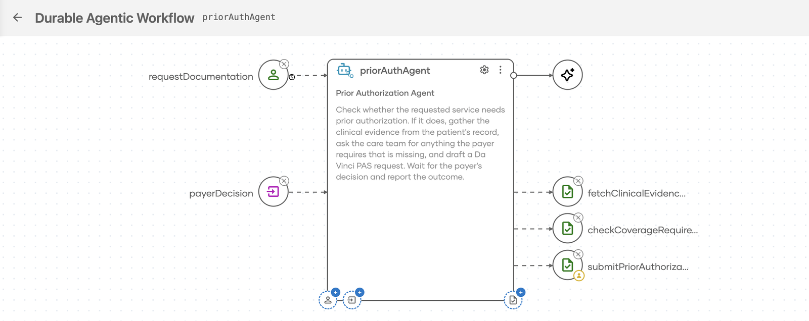

# Build a durable agent

A prior authorization case is not one request. It can take days: the clinician has to approve the request, the care team may have to supply missing documents, and the payer answers when it answers. An ordinary agent run cannot wait that long, and it should not redo a payer submission because a server restarted.

A **durable agent**, built with the [`ballerina/workflow`](https://central.ballerina.io/ballerina/workflow) module, solves this. It runs as a durable workflow:

| Capability | What it means for prior authorization |
|---|---|
| **Checkpointed activities** | Each FHIR or payer call is an activity. A completed activity is recorded and never re-run, so a restart never submits a request twice. |
| **Retry policies** | Activities that call flaky external APIs retry with backoff. |
| **Approval policies** | A person approves an activity before it runs. Here, a clinician approves every submission to the payer. |
| **Human tasks** | The agent asks a person for something and waits, with a timeout. Here, it asks the care coordinator for missing documents and waits up to 72 hours. |
| **Events** | The agent waits for data that arrives later. Here, the payer's decision resumes the case days after the submission. |



## Prerequisites

1. [WSO2 Integrator](https://wso2.com/products/downloads/?product=wso2integrator) installed, and signed in to WSO2 Integrator Copilot. The sample uses WSO2 Integrator's default model provider.
2. The WSO2 FHIR Server running at `http://localhost:8080/fhir/r4` with the sample case loaded. Follow [Step 1](./build-a-healthcare-agent.md#step-1-start-the-wso2-fhir-server-and-the-fhir-mcp-server) and [Step 2](./build-a-healthcare-agent.md#step-2-load-the-sample-case) of [Build a healthcare agent](./build-a-healthcare-agent.md).
3. `curl` or any HTTP client for testing.

## Get the sample

Download the source project: [durable-prior-auth-agent.zip](pathname:///assets/attachments/ai-agents/durable-prior-auth-agent.zip). It contains:

| File | Purpose |
|---|---|
| `agents.bal` | The durable agent: activities, approval policy, human task, and event. |
| `functions.bal` | The three activities: read clinical evidence, check coverage requirements, and submit the request. |
| `connections.bal` | HTTP clients for the EHR's FHIR API and the payer API. |
| `main.bal` | An HTTP service to start a case, deliver the payer's decision, and read the outcome. |
| `mock_payer.bal` | A stand-in for the payer's Coverage Requirements Discovery (CRD) and Prior Authorization Support (PAS) APIs, on port `9091`. |
| `types.bal` | The request, coverage requirements, payer decision, and outcome types. |
| `Config.toml` | The FHIR and payer URLs, and the workflow runtime mode. |

## Step 1: Review the activities

Activities are ordinary functions marked `@workflow:Activity`. The agent calls them as tools, and the workflow runtime records each result.

```ballerina
# Read the patient's active conditions, recent observations, and current medications from the EHR.
#
# + patientId - FHIR id of the patient
# + return - A FHIR searchset Bundle with the clinical evidence
@workflow:Activity
function fetchClinicalEvidence(string patientId) returns json|error {
    return ehrFhir->get(string `/Condition?patient=${patientId}&clinical-status=active`);
}

# Look up the payer's coverage rules and documentation requirements for a service.
#
# + payerId - Identifier of the patient's payer
# + serviceCode - CPT or HCPCS code of the requested service
# + return - The payer's coverage requirements
@workflow:Activity
function checkCoverageRequirements(string payerId, string serviceCode) returns CoverageRequirements|error {
    return payerApi->get(string `/crd/${payerId}/${serviceCode}`);
}

# Submit a prior authorization request (Da Vinci PAS Claim) to the payer.
#
# + claim - The PAS Claim bundle drafted by the agent
# + return - The id of the payer's ClaimResponse
@workflow:Activity
function submitPriorAuthorization(json claim) returns string|error {
    return payerApi->post("/pas/Claim/$submit", claim);
}
```

## Step 2: Review the durable agent

`workflow:DurableAgent` declares everything the agent can do, and the rules around it, in one place:

```ballerina
final workflow:DurableAgent priorAuthAgent = check new ({
    systemPrompt: {
        role: "Prior Authorization Agent",
        instructions: string `Check whether the requested service needs prior authorization.
            If it does, gather the clinical evidence from the patient's record, ask the care
            team for anything the payer requires that is missing, and draft a Da Vinci PAS
            request. Wait for the payer's decision and report the outcome.`
    },
    model: check ai:getDefaultModelProvider(),
    inputType: PriorAuthRequest,
    resultType: PriorAuthOutcome,
    activities: [
        fetchClinicalEvidence,
        {activity: checkCoverageRequirements, retryPolicy: {maxRetries: 3}},
        {
            activity: submitPriorAuthorization,
            approvalPolicy: {userRoles: "clinician", title: "Review the prior authorization request"}
        }
    ],
    humanTasks: {
        requestDocumentation: {
            userRoles: "care-coordinator",
            title: "Provide missing clinical documentation",
            timeout: {hours: 72}
        }
    },
    events: {
        payerDecision: {request: PayerDecision, cardinality: workflow:SINGLE_EVENT}
    }
});
```

- **`inputType` and `resultType`** make the case typed. A case starts from a `PriorAuthRequest` and ends with a `PriorAuthOutcome`, so callers get a structured result instead of free text.
- **`retryPolicy`** on `checkCoverageRequirements` retries the payer's CRD API up to three times with backoff.
- **`approvalPolicy`** on `submitPriorAuthorization` raises a review for the `clinician` role before every submission. The submission runs only after a clinician approves it, and is skipped if they reject it.
- **`humanTasks`** lets the agent ask a care coordinator for missing documentation. The case waits durably for up to 72 hours.
- **`events`** declares the `payerDecision` channel. The case pauses after the submission and resumes when the decision arrives.

## Step 3: Review the service

`main.bal` exposes three operations. Starting a case returns at once with a case id, because the case itself can run for days:

```ballerina
service /prior\-auth on new http:Listener(8086) {

    # Start a prior authorization case. Returns at once with the case id.
    resource function post .(PriorAuthRequest request) returns record {|string caseId;|}|error {
        string caseId = check priorAuthAgent.run(
            string `Prior authorization for ${request.serviceCode}`, request);
        return {caseId};
    }

    # Deliver the payer's decision, which may arrive days later.
    resource function post [string caseId]/decision(PayerDecision decision) returns error? {
        _ = check priorAuthAgent.sendData(caseId, "payerDecision", decision);
    }

    # Read the outcome of a case.
    resource function get [string caseId]() returns PriorAuthOutcome|error {
        return priorAuthAgent.getResult(caseId);
    }
}
```

## Step 4: Run the agent

`Config.toml` runs the workflow runtime in `IN_MEMORY` mode, which needs no extra infrastructure and is meant for development:

```toml
ehrFhirUrl = "http://localhost:8080/fhir/r4"
payerApiUrl = "http://localhost:9091/payer"

[ballerina.workflow]
mode = "IN_MEMORY"
```

Open the `durable_prior_auth_agent` folder in WSO2 Integrator and click **Run**, or run `bal run` in that folder. The service starts on port `8086`, and the mock payer on port `9091`.

:::note
`IN_MEMORY` mode keeps workflow state in memory, so cases do not survive a restart. To get durability across restarts, set `mode` to a persistent runtime (`LOCAL`, `SELF_HOSTED`, or `CLOUD`). See the [`ballerina/workflow`](https://central.ballerina.io/ballerina/workflow) module documentation for the options.
:::

## Step 5: Run a case

1. Start a case for the MRI order:

   ```bash
   curl -s -X POST http://localhost:8086/prior-auth \
     -H 'Content-Type: application/json' \
     -d '{"patientId":"pa-1001","payerId":"acme-health","serviceCode":"73721","orderingPractitioner":"Practitioner/dr-lee"}'
   ```

   The response contains the case id, for example `{"caseId":"..."}`.

2. The agent reads the clinical evidence and checks the payer's requirements. The mock payer says MRI codes need prior authorization, with an active diagnosis, at least six weeks of conservative treatment, and a current pain score.

3. Before `submitPriorAuthorization` runs, the approval policy raises a review for the `clinician` role. The case waits until a clinician approves it. If evidence is missing, the agent raises the `requestDocumentation` human task for the care coordinator instead.

4. After the submission, the case waits for the payer. Deliver the decision, which in production arrives days later:

   ```bash
   curl -s -X POST http://localhost:8086/prior-auth/<caseId>/decision \
     -H 'Content-Type: application/json' \
     -d '{"claimResponseId":"ClaimResponse/cr-1001","outcome":"approved","reason":null}'
   ```

5. Read the outcome:

   ```bash
   curl -s http://localhost:8086/prior-auth/<caseId>
   ```

   While the case is still running, this returns an error that says the workflow is in progress. When it finishes, it returns the typed `PriorAuthOutcome`.

:::note
Approval reviews and human tasks are durable child workflows, assigned to the roles in the agent declaration. How a clinician or coordinator sees and completes them depends on your deployment, for example a task inbox built on the workflow module's task APIs. See the [`ballerina/workflow`](https://central.ballerina.io/ballerina/workflow) module documentation.
:::

## What's next

- [Govern agents with WSO2 Agent Manager](./govern-agents.md) to trace each case.
- [Build a healthcare agent](./build-a-healthcare-agent.md) for an interactive agent that uses the FHIR MCP Server's tools.
